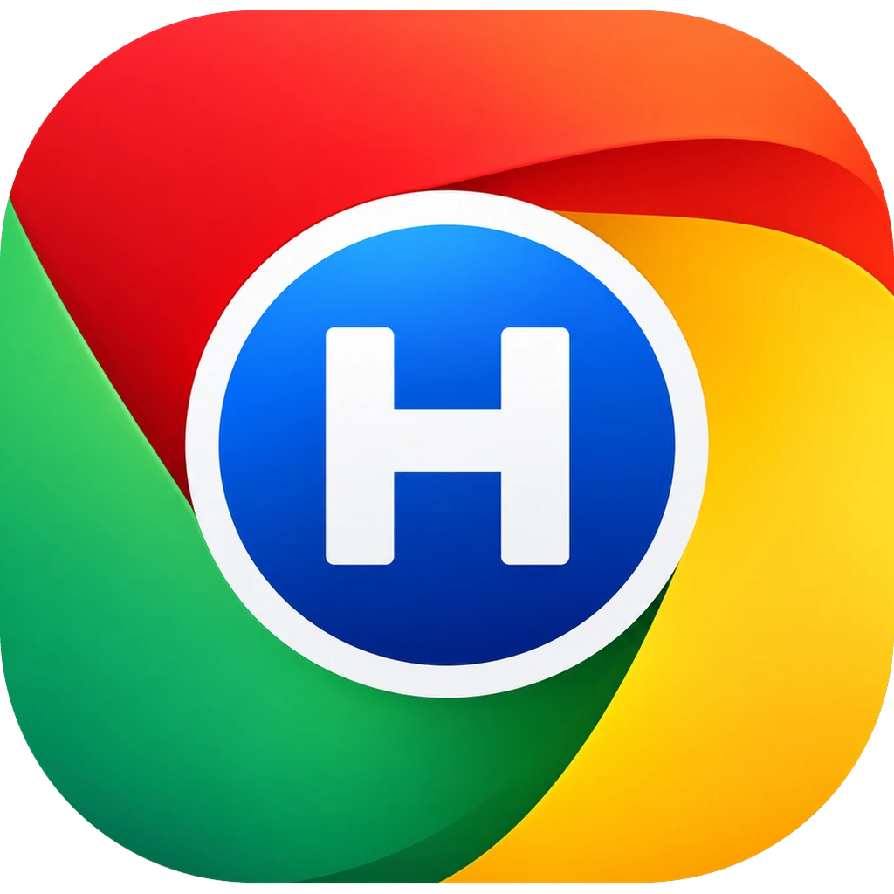

<p align="center">
  
</p>

<h1 align="center">Hussein Browser</h1>

<p align="center">
  A fast, simple web browser that blocks ads, trackers and popups out of the box.<br>
  <b>Free. Open source. No accounts, no telemetry.</b>
</p>

<p align="center">
  <a href="https://github.com/Alawieh/hussein-browser/releases/latest"><b>⬇ Download for Windows</b></a>
</p>

---

## Install (Windows)

1. Go to the **[latest release](https://github.com/Alawieh/hussein-browser/releases/latest)**.
2. Download **`Hussein-Browser-Setup-x.x.x.exe`**.
3. Double-click it. It installs and opens automatically, and adds a Desktop and Start Menu shortcut.

> **"Windows protected your PC"?** That warning shows for apps without a paid code-signing certificate.
> Click **More info**, then **Run anyway**. The full source is right here if you want to check it.

**Don't want to install anything?** Download **`Hussein-Browser-Portable-x.x.x.exe`** instead and just run it. You can keep it on a USB stick.

**Uninstall:** Windows Settings → Apps → Installed apps → *Hussein Browser* → Uninstall.

---

## Features

- **Ad and tracker blocking.** Uses the same community filter lists as popular ad blockers (EasyList, EasyPrivacy and others) through the [Ghostery adblocker engine](https://github.com/ghostery/adblocker). Lists update automatically.
- **Popup blocking.** A site can only open a new tab right after you click. Popups that match ad filters are blocked even then.
- **Wall remover.** Get rid of paywall overlays, "disable your ad blocker" boxes, cookie walls and sign-up pop-ups. It also unlocks scrolling and turns right-click and text selection back on.
- **Hide any element.** Right-click anything and choose *Hide This Element*. It stays hidden every time you visit that site.
- **Tabs, address bar with Google search, back/forward/reload.**
- **Shield counter.** The green shield shows how many things were blocked on the current page. Click it to turn blocking off for a moment.

### Keyboard shortcuts

| Shortcut | Action |
|---|---|
| `Ctrl+Shift+H` | Hide the element under your mouse |
| `Ctrl+Shift+X` | Remove walls / overlays on this page |
| `Ctrl+Shift+M` | Open the tools menu at your mouse (works even when a site blocks right-click) |
| `Ctrl+T` / `Ctrl+W` | New tab / close tab |
| `Ctrl+L` | Jump to the address bar |
| `Ctrl+R` or `F5` | Reload |
| `Alt+←` / `Alt+→` | Back / forward |
| `F12` | Developer tools |

The `Ctrl+Shift` shortcuts reach the browser before the web page sees them, so sites can't block them.

To undo hidden elements on a site, right-click → **Show Hidden Elements on This Site**.

---

## Free for everyone, do whatever you want with it

This project is released under the **[MIT License](LICENSE)**. In plain words:

- ✅ Use it for free, personally or commercially
- ✅ Copy it, fork it, change it, rename it, rebrand it
- ✅ Ship it inside your own products, open source or closed
- ✅ Sell it if you like

The only condition is to keep the license text in your copy. No permission needed and no need to ask. Pull requests are welcome but never required.

---

## For developers

You need [Node.js](https://nodejs.org) 18 or newer.

```bash
git clone https://github.com/Alawieh/hussein-browser.git
cd hussein-browser
npm install
npm start          # run the browser
npm run dist       # build the Windows installer + portable .exe into dist/
```

### How it's put together

| File | What it does |
|---|---|
| `main.js` | Main process: window, tabs (one `WebContentsView` each), ad blocker setup, popup blocking, navigation |
| `hider.js` | Right-click menu, *Hide This Element*, wall remover, keyboard shortcuts, per-site memory of hidden elements |
| `ui/` | The tab bar and toolbar (HTML/CSS/JS) and its preload bridge |
| `build/` | App icon used for the installer |

Some useful places to start:

- **Change the home page or search engine:** `HOME` and `normalizeInput()` at the top of `main.js`.
- **Use different filter lists:** replace `ElectronBlocker.fromPrebuiltAdsAndTracking` in `initBlocker()` with `fromPrebuiltFull` (adds cookie banners and annoyances) or `fromLists(fetch, [urls])`.
- **Build for macOS/Linux:** add `mac` / `linux` targets in the `build` section of `package.json` and run `npx electron-builder --mac` or `--linux` on that OS.

### Security

Web pages run sandboxed with `contextIsolation` on and Node.js turned off. Only the browser's own toolbar can talk to the main process, through a small allow-list of messages.

Your data stays on your computer. Browsing data and the list of hidden elements are saved in `%APPDATA%\Hussein Browser`.

---

## Known limits

- Ad blocking is filter-list based, so **YouTube video ads are not reliably blocked**.
- Some paywalls never send the article to your browser at all. The wall remover can't bring back text that was never loaded.
- No bookmarks, history page, sync or extensions yet. PRs welcome!

## Credits

- Ad blocking engine: [@ghostery/adblocker](https://github.com/ghostery/adblocker) (MPL-2.0)
- Built on [Electron](https://www.electronjs.org)
